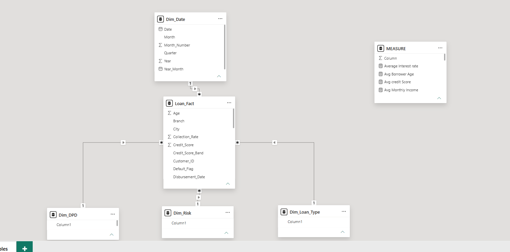
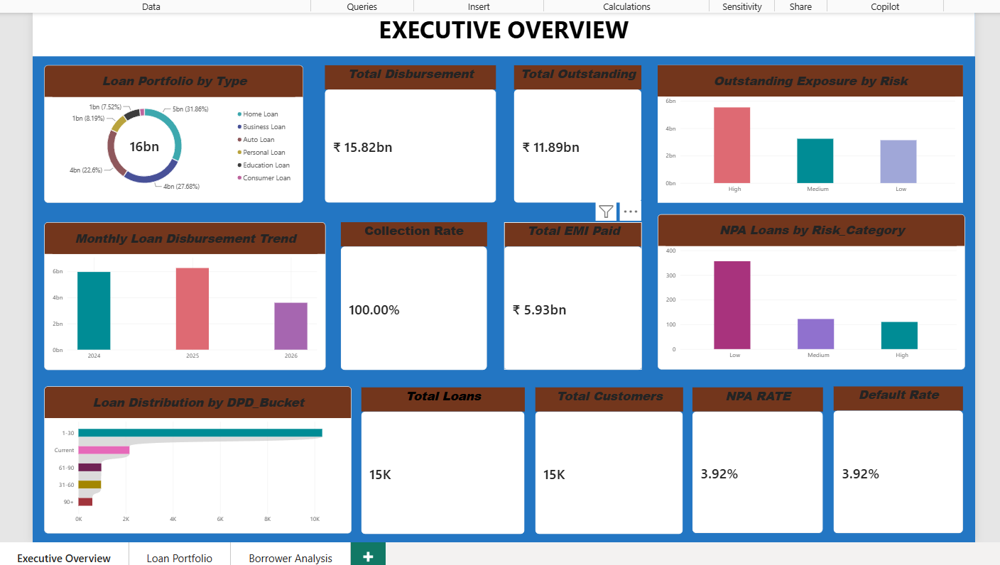
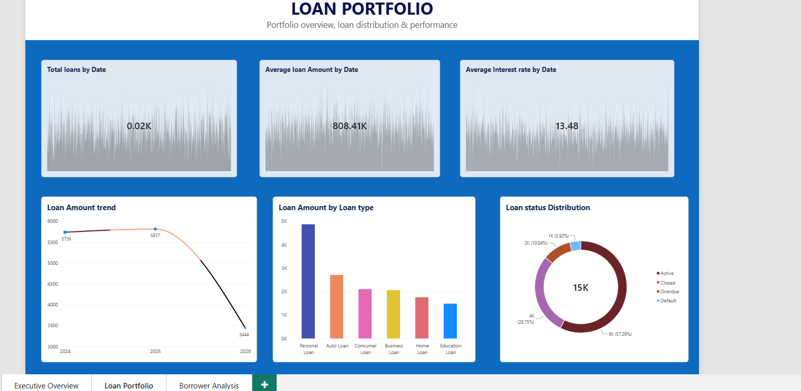
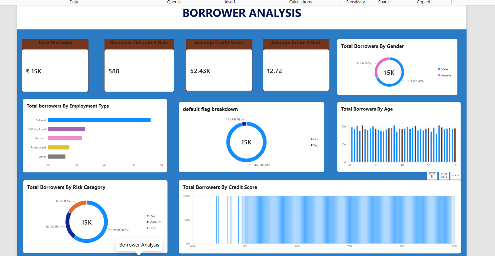

# Fintech Loan Risk Analytics Dashboard

A 3-page interactive Power BI dashboard analyzing a ₹15.82bn loan portfolio across 15,000 borrowers and 6 loan products.

## Pages
- **Executive Overview:** portfolio performance and key KPIs
- **Loan Portfolio:** loan distribution by product
- **Borrower Analysis:** risk profiling by credit score, employment type, age, and DPD bucket

## Key Insights
- Portfolio default rate: 3.92%
- 20+ DAX measures: NPA rate, default rate, collection rate, risk-tier exposure (High/Medium/Low)

## Data Model
Star schema: Loan_Fact with Dim_Date, Dim_Risk, Dim_DPD, Dim_Loan_Type

## Screenshots

### Executive Overview

### Loan Portfolio

### Borrower Analysis

## Tools
Power BI, DAX
